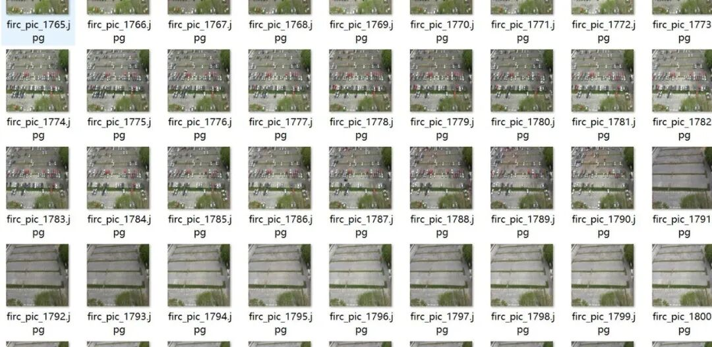
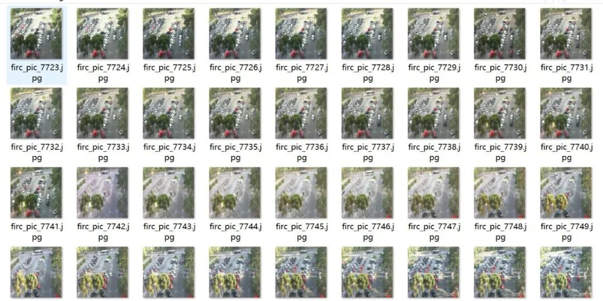
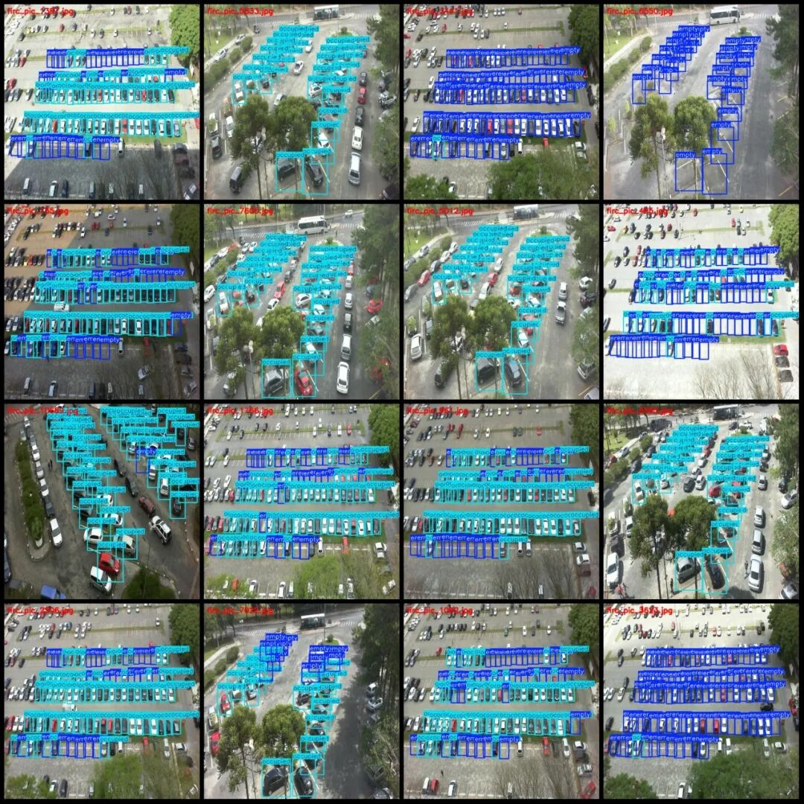
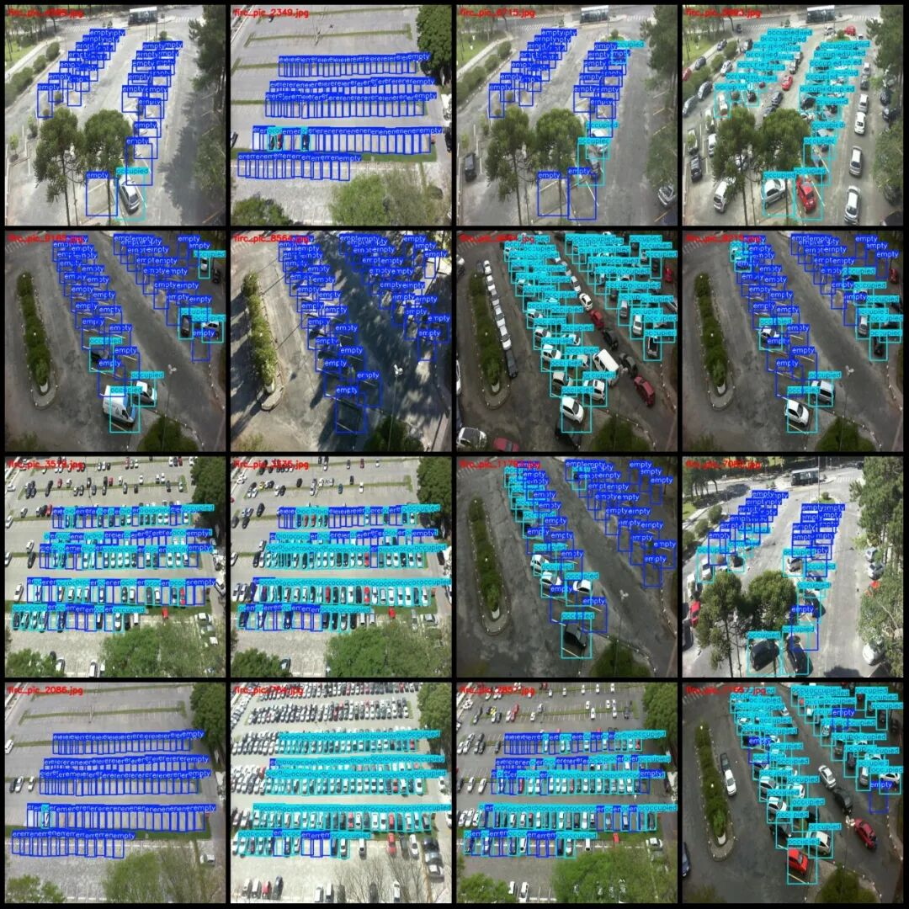
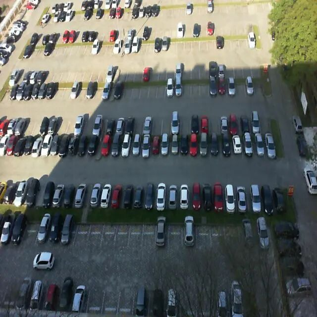
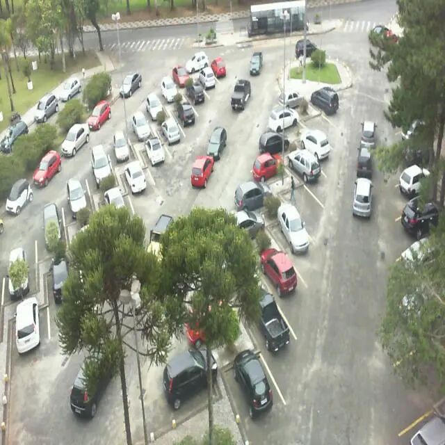
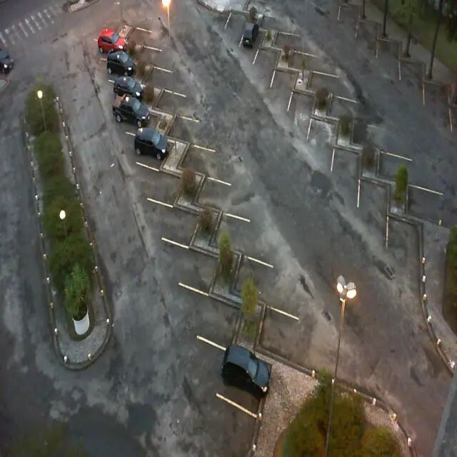

# Vehicle Observation Dataset for Drone - Format VOC+YOLO with 12,142 images in 2 categories

Please note that the dataset contains approximately four scenes, and each scene has images of parking lot occupancy at different time periods. Therefore, there are many repetitive images (actually).

Please note that the dataset contains approximately four scenes, and each scene has images of parking lot occupancy at different time periods. Therefore, there are many repetitive images (actually not duplicates), please review the images carefully.

Dataset format: Pascal VOC format + YOLO format (txt file without split path, only containing jpg images and corresponding VOC format xml files and yolo format txt files)

Number of images (number of jpg files): 12142

Number of annotations (number of xml files): 12142

Number of annotations (number of txt files): 12142

Labeling category count: 2

Label category names (Note that the order of yolo format categories does not correspond to this, but is based on the labels folder's classes.txt): ["empty", "occupied"]

Number of boxes labeled in each category:

Empty (free) frame count = 376121

Occupied (occupation) box count = 335735

Total frames: 711856

Number of images per category:

Empty (idle) occupancy = 10468

Occupied (occupy) = 9718

Image resolution: 640x640

Using labelImg:

Annotation rules: Draw a rectangle around the category.

Important Notice: The dataset does not have separate training, validation, and test sets; you need to partition them yourself.

Special : This dataset does not guarantee the accuracy of the trained models or weight files.

Image Preview:

Annotation example:

Single image:

## Payment

Here is a pay link on Stripe ( https://buy.stripe.com/3cs8yP7sY87d0vu9AB ). Please contact me lonlonago@foxmail.com after funding $89, and I will send you a complete data files , thank you!

